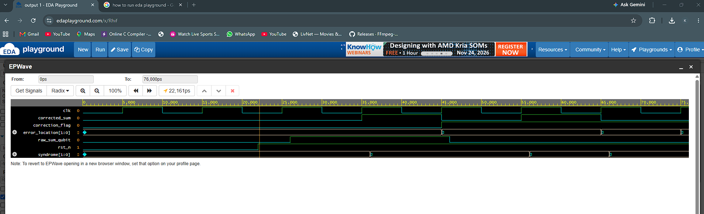

# Reversible Quantum Full Adder with 3-Qubit Bit-Flip Code and Verilog Syndrome Decoder

A hybrid quantum-classical demo: a reversible Peres-gate full adder in Qiskit,
a 3-qubit repetition code protecting the sum bit against single bit-flip errors,
and a synthesizable Verilog decoder that corrects the sum from the measured syndrome.

## Pipeline

```
[A, B, Cin] -> [Reversible Peres full adder] -> [Sum, Cout]
                         |
        [3-qubit repetition encoding of Sum]
                         |
        [Single bit-flip fault injection (X gate)]
                         |
        [Stabilizer checks: Z0Z1, Z1Z2] -> syndrome {S1, S0}
                         |
        [Verilog syndrome decoder (registered output)]
                         |
                [Corrected Sum]
```

## Syndrome decoding

| Fault location | Syndrome {S1,S0} | Decoder action | error_location |
| :--- | :--- | :--- | :--- |
| None | 2'b00 | Pass raw sum | 2'b00 |
| Qubit 0 (sum qubit) | 2'b01 | Invert raw sum | 2'b01 |
| Qubit 1 (ancilla 1) | 2'b11 | Pass raw sum | 2'b10 |
| Qubit 2 (ancilla 2) | 2'b10 | Pass raw sum | 2'b11 |

## Repository structure

```
quantum/circuit_quantum_alu.py   Qiskit adder, encoding, fault injection, syndrome extraction
vlsi/syndrome_decoder.v          Verilog decoder (async active-low reset, registered outputs)
vlsi/tb_decoder.v                Self-checking testbench
```

## Run

[Vivado / EDA Playground / Icarus Verilog] with EDA Playground (Icarus Verilog)

```
python quantum/circuit_quantum_alu.py
```

**Verilog simulation:** load both files from `vlsi/` into [Vivado / EDA Playground / Icarus Verilog].
The testbench prints PASS/FAIL per case and `ALL TESTS PASSED` at the end.

## Results
```
=== QUANTUM ALU WITH 3-QUBIT BIT-FLIP CODE ===
[Normal (No Noise)] Inputs (A=1, B=1, Cin=0) -> Raw [Cout,Sum]: 10 | Syndrome (S1,S0): 00 | Corrected Sum: 0
[Bit-Flip on Primary] Inputs (A=1, B=1, Cin=0) -> Raw [Cout,Sum]: 11 | Syndrome (S1,S0): 01 | Corrected Sum: 0
[Bit-Flip on Ancilla 1] Inputs (A=1, B=1, Cin=0) -> Raw [Cout,Sum]: 10 | Syndrome (S1,S0): 11 | Corrected Sum: 0
[Bit-Flip on Ancilla 2] Inputs (A=1, B=1, Cin=0) -> Raw [Cout,Sum]: 10 | Syndrome (S1,S0): 10 | Corrected Sum: 0

All 32 cases passed
```



## Limitations

- Local simulation only (Qiskit Aer); not run on quantum hardware.
- Only the sum qubit is encoded, and only after the adder. Errors inside the adder or on the carry are not protected.
- The code corrects single bit-flip (X) errors only, not phase errors.
- Faults are single deterministic X gates, not a statistical noise model.
- All inputs are computational basis states.